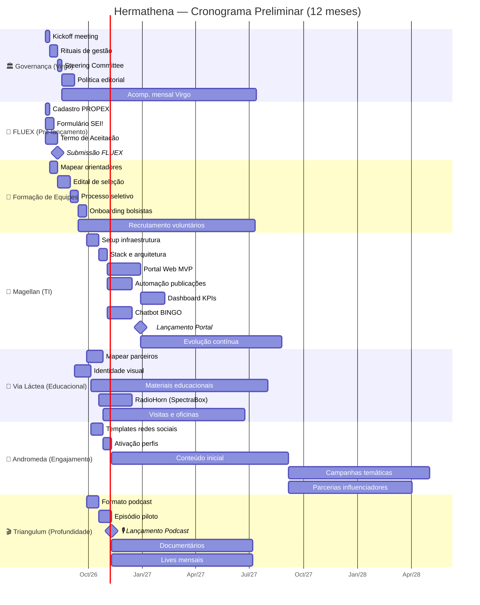

# Planejamento Hermathena — Tarefas, Dependências & Gantt Preliminar

> Gerado em 19/jul/2026 | Kickoff: 20/jul/2026

---

## 🎯 Visão Geral do Programa

```
Hermathena — Comunicação Multimídia do Radiotelescópio BINGO
├── 🏛️ Virgo (Steering Committee) — Coordenação Geral
├── 🔧 Magellan    — Tecnologia da Informação (Portal, Automação, Dashboards)
├── 🌌 Via Láctea  — Comunicação Educacional (Material Didático, RadioHorn, Visitas)
├── 💫 Andromeda   — Comunicação de Engajamento (Redes Sociais, Campanhas)
└── 🎬 Triangulum  — Comunicação de Profundidade (Podcast, YouTube, Documentários)
```

---

## 📋 Eixos de Trabalho (sem microgerenciamento)

### Eixo A — 🏛️ Governança e Coordenação (Virgo)
| # | Tarefa | Depende de | Duração estimada |
|---|--------|-----------|:---:|
| A1 | Kickoff meeting — alinhamento de visão e papéis | — | 1 semana |
| A2 | Definir rituais de gestão (reuniões, reports, canais) | A1 | 2 semanas |
| A3 | Estabelecer Steering Committee (calendário, pautas) | A2 | 1 semana |
| A4 | Definir política editorial e diretrizes estratégicas | A3 | 3 semanas |
| A5 | Acompanhamento mensal — reuniões Virgo | A3 | Contínuo (M1–M12) |
| A6 | Relatório de Fase 1 (M4) | A4, B2, C2, D2, E2 | — |
| A7 | Relatório Final + Planejamento Ano 2 (M12) | Todos | — |

### Eixo B — 👥 Formação e Estruturação das Equipes
| # | Tarefa | Depende de | Duração estimada |
|---|--------|-----------|:---:|
| B1 | Mapear e convidar orientadores/colaboradores para cada núcleo | A1 | 2 semanas |
| B2 | Lançar edital de seleção de bolsistas (4 vagas) | B1 | 3 semanas |
| B3 | Processo seletivo (análise + entrevistas) | B2 | 2 semanas |
| B4 | Integração e onboarding dos bolsistas | B3 | 2 semanas |
| B5 | Recrutamento contínuo de voluntários | B3 | Contínuo |

### Eixo C — 🔧 Magellan: Infraestrutura Tecnológica
| # | Tarefa | Depende de | Duração estimada |
|---|--------|-----------|:---:|
| C1 | Setup de infraestrutura (servidores, domínios, repositórios) | B4 | 3 semanas |
| C2 | Definição de stack tecnológica e arquitetura | C1 | 2 semanas |
| C3 | Desenvolvimento do Portal Web (MVP) | C2 | 8 semanas |
| C4 | Sistema de automação de publicações | C2 | 6 semanas |
| C5 | Dashboard de KPIs e métricas | C3 | 6 semanas |
| C6 | Chatbot BINGO (FAQ e atendimento) | C2 | 6 semanas |
| C7 | Lançamento do Portal v1.0 | C3 | — |
| C8 | Manutenção e evolução contínua | C7 | Contínuo (M5–M12) |

### Eixo D — 🌌 Via Láctea: Comunicação Educacional
| # | Tarefa | Depende de | Duração estimada |
|---|--------|-----------|:---:|
| D1 | Mapeamento de parceiros (escolas, institutos, secretarias) | B4 | 4 semanas |
| D2 | Definição de identidade visual e manual de marca | A4 | 4 semanas |
| D3 | Produção de materiais educacionais (cartilhas, roteiros) | D2 | Contínuo |
| D4 | Desenvolvimento do RadioHorn (frontend SpectraBox) | C1 | 8 semanas |
| D5 | Planejamento de visitas escolares e oficinas | D1 | 2 semanas |
| D6 | Início das visitas e atividades presenciais | D5 | Contínuo (M4–M12) |

### Eixo E — 💫 Andromeda: Comunicação de Engajamento
| # | Tarefa | Depende de | Duração estimada |
|---|--------|-----------|:---:|
| E1 | Criação de templates e identidade para redes sociais | D2 | 3 semanas |
| E2 | Ativação dos perfis (Instagram, TikTok, Facebook) | E1 | 2 semanas |
| E3 | Produção de conteúdo inicial (Reels, carrosséis) | E2 | Contínuo |
| E4 | Campanhas temáticas mensais | E3 | Contínuo (M5–M12) |
| E5 | Parcerias com influenciadores e criadores locais | E3 | Contínuo (M6–M12) |

### Eixo F — 🎬 Triangulum: Comunicação de Profundidade
| # | Tarefa | Depende de | Duração estimada |
|---|--------|-----------|:---:|
| F1 | Definição de formato e linha editorial do podcast | A4, B4 | 3 semanas |
| F2 | Roteirização e gravação de episódio piloto | F1 | 3 semanas |
| F3 | Lançamento do podcast "Cosmos em Foco" | F2 | — |
| F4 | Criação do canal no YouTube | B4 | 2 semanas |
| F5 | Produção de documentários curtos (4 no Ano 1) | F4 | Contínuo (M5–M12) |
| F6 | Lives e webinários mensais | F4 | Contínuo (M5–M12) |

### Eixo G — 📄 Pendências FLUEX (pré-lançamento)
| # | Tarefa | Depende de | Duração estimada |
|---|--------|-----------|:---:|
| G1 | Cadastro de Comunicação no site da PROPEX | — | 1 semana |
| G2 | Extrair conteúdo para formulário SEI! | — | 2 semanas |
| G3 | Obter assinatura do Termo de Aceitação (BINGO/UFCG) | — | 3 semanas |
| G4 | Submissão final do FLUEX | G1, G2, G3 | — |

---

## 🔗 Matriz de Dependências

```
G1──┐
G2──┼──▶ Submissão FLUEX
G3──┘

A1──▶ A2──▶ A3──▶ A4──▶ A5 (contínuo)
                    │
     ┌──────────────┤
     ▼              ▼
    B1──▶ B2──▶ B3──▶ B4──▶ Integração
                              │
         ┌────────────────────┼────────────────────┐
         ▼                    ▼                    ▼
    C1──▶ C2──▶ C3──▶ C7    D1──▶ D5──▶ D6       E1──▶ E2──▶ E3
         │         │         │         │           │
         │         ▼         ▼         ▼           ▼
         └──▶ C4   C5   C6  D3  D4     D6         E4  E5
    
    F1──▶ F2──▶ F3──▶ F5, F6
```

---

## 📅 Gantt Preliminar — 12 Meses



---

## 🗓️ Marcos Principais (Milestones)

| Marco | Previsão | Eixo |
|-------|:--------:|:----:|
| 🥇 Kickoff do Programa | 20/jul/2026 | A |
| 📄 Submissão FLUEX | até 15/ago/2026 | G |
| 👥 Equipes completas (bolsistas onboard) | até 15/set/2026 | B |
| 🎨 Identidade visual definida | até 15/out/2026 | D/A |
| 🚀 Portal Web v1.0 no ar | até 15/dez/2026 | C |
| 🎙️ Podcast "Cosmos em Foco" lançado | até 15/dez/2026 | F |
| 📱 Redes sociais ativas | até 15/nov/2026 | E |
| 📊 Relatório Fase 1 | até 15/dez/2026 | A |
| 🌟 Início expansão (parcerias, eventos) | a partir de mar/2027 | Todos |
| 🏁 Relatório Final + Planejamento Ano 2 | até 20/jul/2027 | A |

---

## 💡 Notas para a Kickoff

1. **Prioridade imediata:** Resolver pendências FLUEX (G1–G3) em paralelo ao kickoff
2. **Ação crítica:** Mapear orientadores (B1) já na primeira semana — sem orientadores não há edital
3. **Identidade visual (D2):** Atrasa Andromeda (E1) e isola a marca — vale investir esforço inicial concentrado
4. **RadioHorn (D4):** Depende do setup de TI (C1), mas pode começar conceitualmente antes
5. **Ritmo sugerido para reuniões:** Produção quinzenal por núcleo + Virgo mensal + planejamento integrado trimestral
