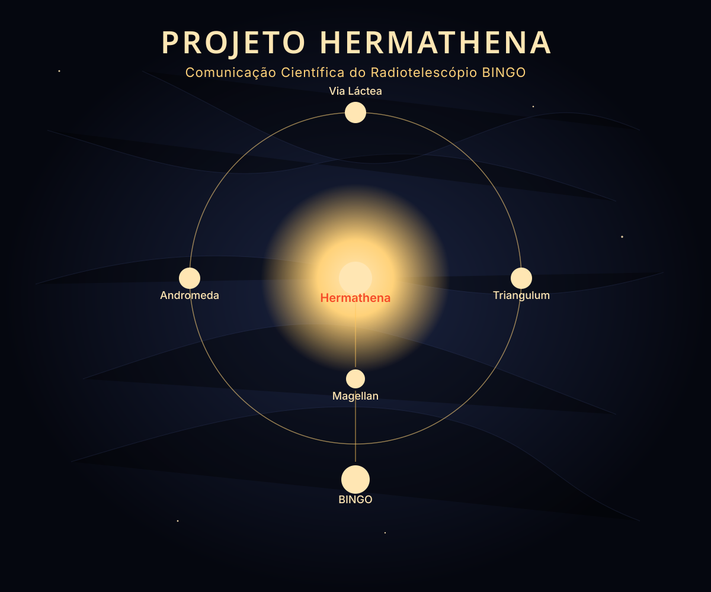
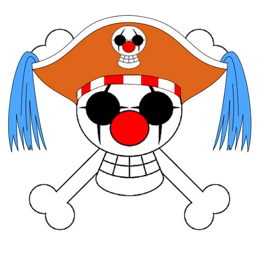
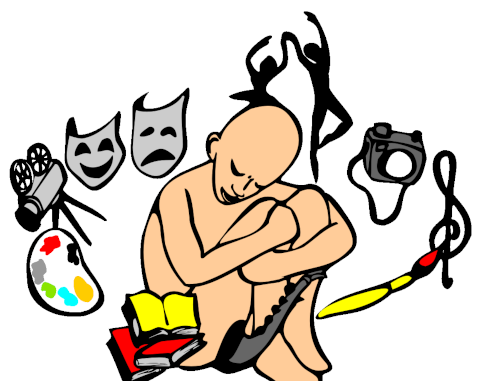
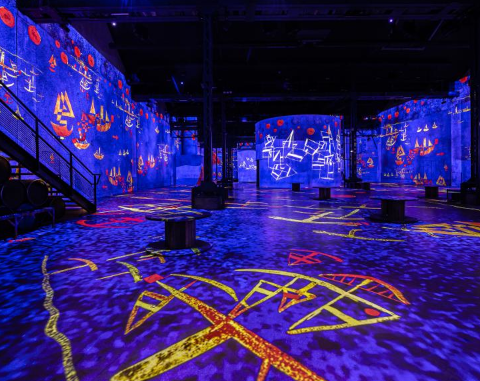
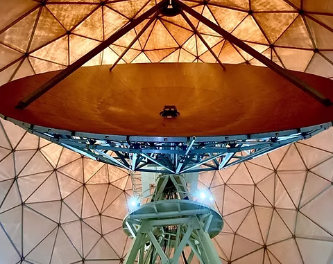
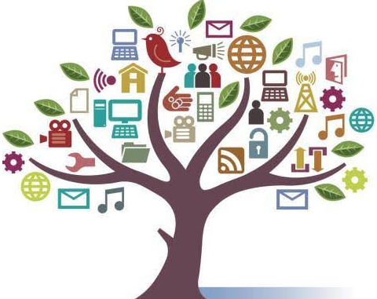
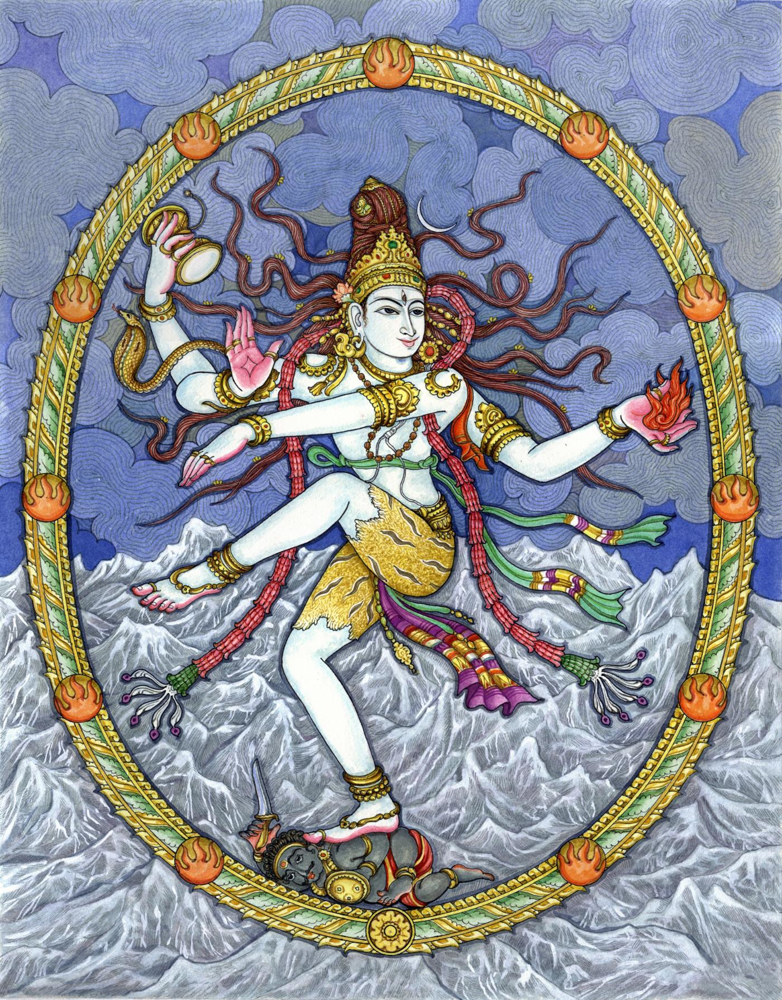
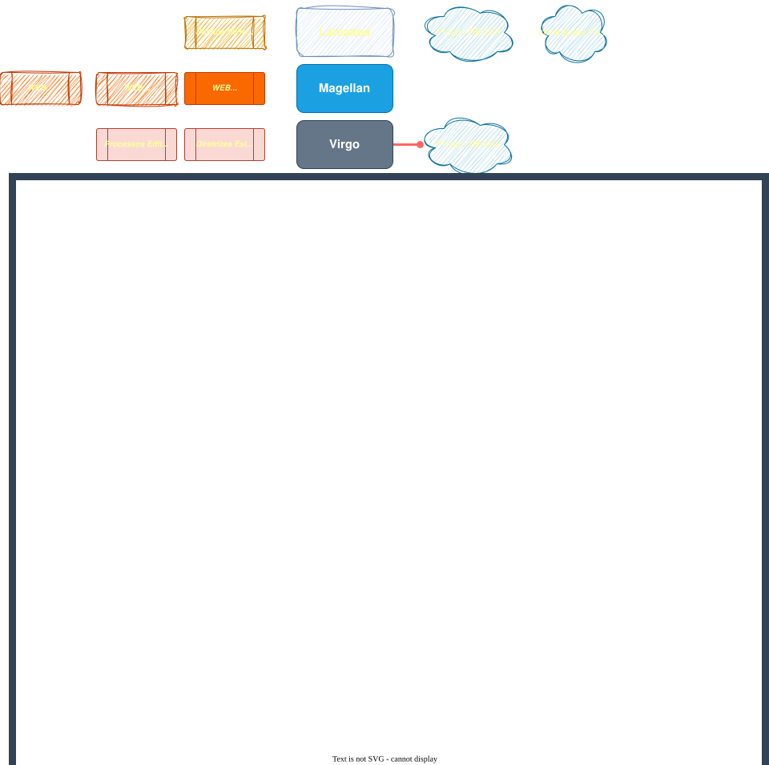
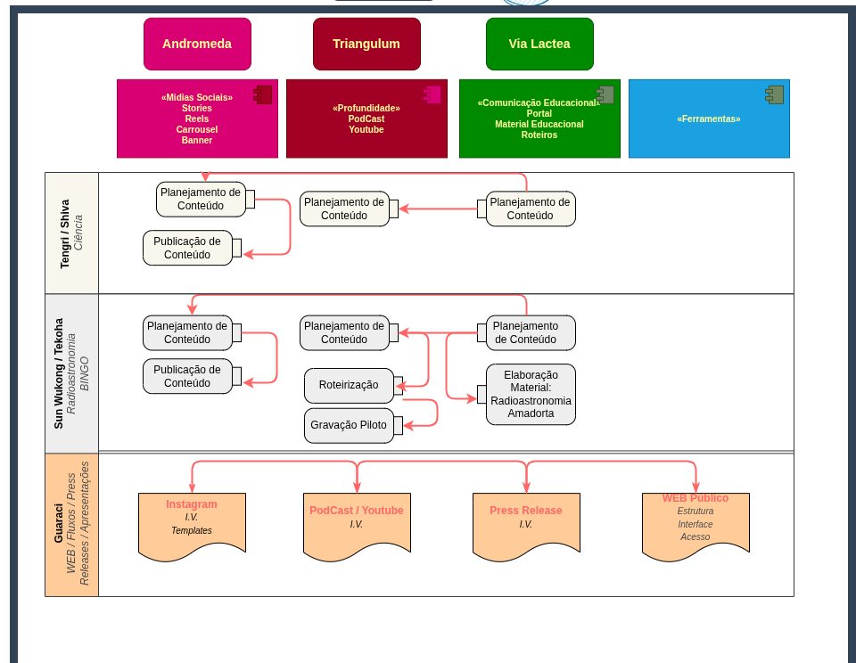

---

# **Por que agora?**

* **Perdemos a oportunidade do PROBEX**
* **Quanto mais cedo começarmos, melhores as chances de incorporar parceiros**
* *Necessidade objetiva de um aluno para registro de atividades*
* **Necessidade de posicionamento estratégico**
---

---

# **Objetivo Imediato?**

* **Estabelecermos uma equipe para cada um dos núcleos**
* **Compreendermos a fotografia onde estamos inseridos**
* **Pontapé inicial para as atividades**

---
# **Quem Somos?**

> Eu fui até onde pude sem o input de profissionais, agora precisamos construir uma estrutura que implemente uma boa ideia.

> Não é admissível que um projeto desta dimensão permaneça sem planejamento nas suas ações de comunicação e educação científica.

---
# **Quem Somos?**

<!-- _class: small-table -->
| Produção Cultural | Audiovisual | Ciência | Editoração | Educomunicação | Educação Científica | Computação |
|:-:|:-:|:-:|:-:|:-:|:-:|:-:|

---

<!-- _class: dense -->
# **Onde queremos chegar?**
## Nataraja — A Dança Cósmica

* Núcleos estabelecidos e funcionando em diversas instituições
* Qualidade editorial e uniformidade na identidade
* Rastreabilidade dos conteúdos produzidos
* Conteúdos articulados contando uma boa história
* Bases para comunicação científica da colaboração BINGO
* Terreno para iniciativas independentes de destaque na sociedade paraibana e nacional

---

# **O que podemos fazer agora?**

---

