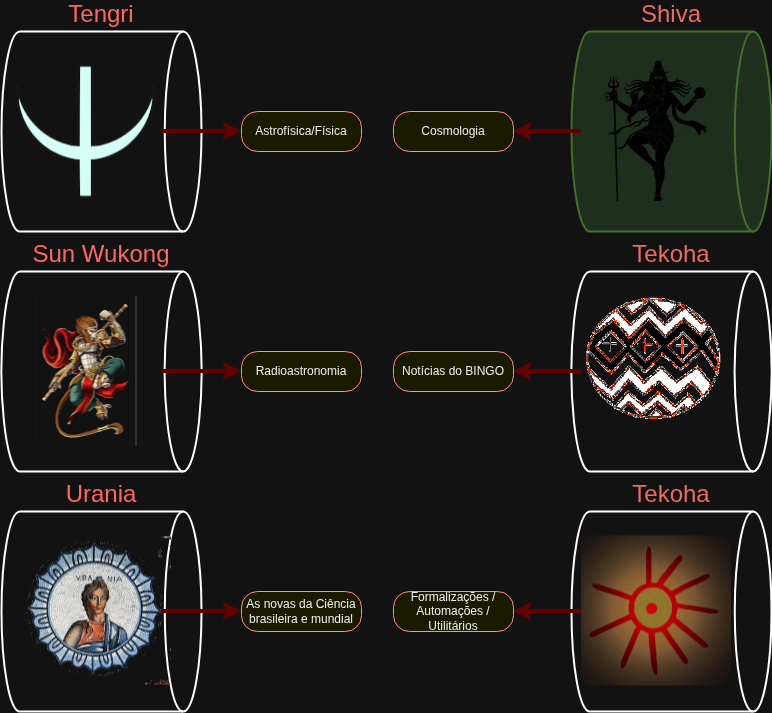

# Eixos Temáticos de Conteúdo

## Conteúdos por Eixo

- **Tengre:** 
  - Como medimos distâncias em astronomia, 
  - Evolução de estrelas, 
  - Pulsares, 
  - Fenômenos transientes de Rádio, 
  - Pulsar Timing Array, 
  - Ondas Gravitacionais
- **Shiva Nataraja:** 
  - A história térmica do universo, 
  - Desacoplamento e recombinação, 
  - Composição do Universo, 
  - Matéria escura, 
  - Energia escura, 
  - Tensão de Hubble
- **Sun Wukong:** 
  - Espectro eletromagnético, 
  - Antenas e receptores, 
  - Sinais digitais de rádio, 
  - Interferências eletromagnéticas, 
  - Planejamento de observações, 
  - Espectrômetro, 
  - Hidrogênio neutro
- **Tekoha:** 
  - Editais e calendário, 
  - Publicações, 
  - Premiações, 
  - Agenda de Eventos, 
  - Modelos digitais, 
  - Andamento da construção, 
  - Notícias das Universidades, 
  - Bolsistas
- **Urania:** 
  - Notícias internacionais, 
  - Clipping de ciência, 
  - Featured article of the month
- **Guaraci:** 
  - Portal, 
  - Templates, 
  - Workflows, 
  - Automação, 
  - Relatórios, 
  - Press releases, 
  - Apresentações para financiadores

---
