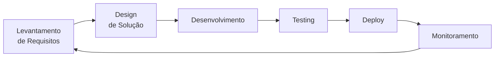
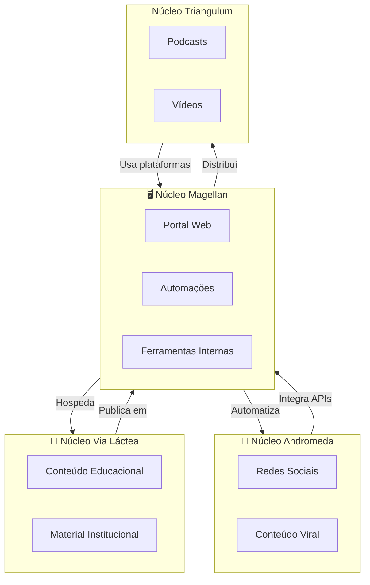

# Núcleo Magellan: Ferramentas TIC

```{figure} ../../assets/images/magellan.jpg
:name: hermathena
:width: 100%
```

## Visão Geral

O **Núcleo Magellan** é responsável pelo desenvolvimento e manutenção das ferramentas tecnológicas de informação e comunicação do Projeto Hermathena. Seu nome evoca as nuvens de Magalhães, símbolo de navegação e orientação, representando nossa missão de criar soluções digitais que guiem e potencializem todo o projeto.

**Afinidade de Área:** Ciência da Computação / Análise e Desenvolvimento de Sistemas / Engenharia de Software

## Missão

Desenvolver, implementar e manter soluções tecnológicas que automatizem processos, facilitem a gestão de conteúdos e proporcionem experiências digitais inovadoras para os diferentes públicos do BINGO.

## Objetivos Específicos

### 1. Desenvolvimento de Sistemas

#### 1.1 Portal Web BINGO
- [ ] Desenvolvimento do site institucional integrado
- [ ] Sistema de gestão de conteúdo (CMS) customizado
- [ ] Área administrativa para equipe
- [ ] Integração com redes sociais
- [ ] Otimização para SEO e acessibilidade

#### 1.2 Sistemas de Automação
- [ ] Automação de publicações em redes sociais
- [ ] Sistema de agendamento e calendário editorial
- [ ] Automação de relatórios e métricas
- [ ] Chatbot para atendimento e FAQ
- [ ] Integração com APIs de plataformas

#### 1.3 Ferramentas Internas
- [ ] Sistema de gestão de documentos
- [ ] Dashboard de acompanhamento de indicadores
- [ ] Ferramenta de versionamento colaborativo
- [ ] Sistema de tickets e demandas
- [ ] Wiki interna do projeto

### 2. Infraestrutura Digital

#### 2.1 Servidores e Hospedagem

| Componente | Especificação | Custo Estimado |
|------------|---------------|----------------|
| **Servidor NAS** | Synology DS1821+ ou similar, 5x HDD 4TB | R$ 20.000,00 |
| **Hospedagem Cloud** | VPS 4vCPU, 8GB RAM, 200GB SSD | R$ 300,00/mês |
| **Backup em Nuvem** | 50TB storage + backup automático | R$ 500,00/mês |

#### 2.2 Serviços de IA

| Serviço | Uso | Custo Estimado |
|---------|-----|----------------|
| **API de IA Generativa** | Chat, assistentes, sumarização | R$ 200,00/mês |
| **Geração de Imagens** | Midjourney/DALL-E para materiais | R$ 50,00/mês |
| **Análise de Dados** | Processamento de métricas | R$ 100,00/mês |

#### 2.3 Sistema MAM/DAM/VAM

Sistema integrado de gestão de mídia:
- **MAM** (Media Asset Management): Organização de vídeos
- **DAM** (Digital Asset Management): Gestão de imagens e documentos
- **VAM** (Video Asset Management): Catalogação e versionamento de vídeos

### 3. Automação e Scripts

#### 3.1 Automação de Marketing Digital

```python
# Exemplo: Pipeline de automação
class ContentAutomation:
    def agendar_conteudo(self, post, data, plataformas):
        """Agenda post em múltiplas plataformas"""
        pass
    
    def gerar_relatorio_metricas(self, periodo):
        """Gera relatório automático de desempenho"""
        pass
    
    def monitorar_mencoes(self):
        """Monitora menções ao BINGO nas redes"""
        pass
```

#### 3.2 Web Scraping e Clipping

- Monitoramento de notícias sobre BINGO
- Coleta automática de menções em mídia
- Análise de sentimento sobre o projeto
- Alertas de publicações relevantes

#### 3.3 CI/CD e DevOps

- Pipeline de deploy automatizado
- Testes automatizados
- Monitoramento de uptime
- Alertas de falhas

### 4. UI/UX e Design de Interação

#### 4.1 Design System

Criação de sistema de design consistente:
- Biblioteca de componentes reutilizáveis
- Guia de estilos digital
- Templates responsivos
- Protótipos interativos

#### 4.2 Experiência do Usuário

- Pesquisa com usuários do portal
- Testes de usabilidade
- Análise de heatmaps
- Otimização de conversão

### 5. Equipamentos de Desenvolvimento

| Equipamento | Quantidade | Custo Unitário | Total |
|-------------|------------|----------------|-------|
| **Monitores 27"** | 3 | R$ 2.000,00 | R$ 6.000,00 |
| **Dispositivos teste (tablets, smartphones)** | 4 | R$ 2.000,00 | R$ 8.000,00 |

### 6. Software e Assinaturas

| Software/Uso | Custo Mensal | Custo Anual |
|--------------|--------------|-------------|
| **Adobe Creative Cloud** (design) | R$ 200,00 | R$ 2.400,00 |
| **Figma Pro** (prototipagem) | R$ 50,00 | R$ 600,00 |
| **Serviços cloud** (AWS/GCP) | R$ 1.200,00 | R$ 14.400,00 |

## Metodologia de Trabalho

### Ciclo de Desenvolvimento



### Stack Tecnológico

| Categoria | Tecnologia |
|-----------|------------|
| **Frontend** | React / Next.js / Tailwind CSS |
| **Backend** | Python (Django/FastAPI) / Node.js |
| **Banco de Dados** | PostgreSQL / Redis |
| **Mobile** | React Native / Flutter |
| **DevOps** | Docker / Kubernetes / GitHub Actions |
| **Cloud** | AWS / Google Cloud Platform |

## Integração com Outros Núcleos

### Fluxo de Trabalho Integrado



## Produtos Esperados

### Ano 1

| Produto | Descrição | Público |
|---------|-----------|---------|
| **Portal Web v1.0** | Site completo com CMS | Geral |
| **Sistema de Automação** | Agendamento e métricas | Equipe |
| **Dashboard de Indicadores** | Visualização de KPIs | Gestão |
| **Chatbot BINGO** | Atendimento automatizado | Visitantes |
| **App mobile (MVP)** | Versão mobile do portal | Geral |
| **API pública** | Dados abertos do projeto | Desenvolvedores |

## Equipe Necessária

| Função | Quantidade | Perfil |
|--------|-----------|--------|
| Coordenador de Núcleo | 1 | Ciência da Computação (Docente) |
| Desenvolvedor Full-stack | 2 | React + Python/Node |
| DevOps / SysAdmin | 1 | Cloud, Docker, CI/CD |
| UX/UI Designer | 1 | Design de interfaces |
| Bolsistas PROBEX | 3 | Ciência da Computação / ADS |
| Voluntários | 5 | Áreas afins |

## Orçamento Estimado (Ano 1)

### Capital (Material Permanente)

| Item | Valor (R$) |
|------|------------|
| Servidor NAS | 20.000,00 |
| **Subtotal Capital** | **81.400,00** |

### Custeio (Mensal/Anual)

| Item | Mensal | Anual |
|------|--------|-------|
| Hospedagem cloud | R$ 150,00 | R$ 1.800,00 |
| Serviços de IA | R$ 100,00 | R$ 1.200,00 |
| Software e licenças | R$ 180,00 | R$ 2.160,00 |
| Bolsa (1 bolsista) | R$ 400,00 | R$ 2.400,00* |
| **Subtotal Custeio** | **R$ 830,00** | **R$ 7.560,00** |

*6 meses de bolsa

### Total Ano 1

| Categoria | Valor (R$) |
|-----------|------------|
| Capital | 34.000,00 |
| Custeio | 7.560,00 |
| **TOTAL** | **41.560,00** |

---

*Documento sujeito a ajustes conforme evolução tecnológica.*
