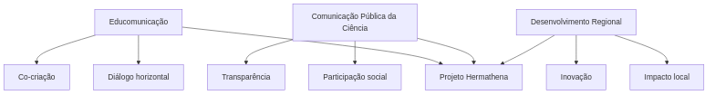
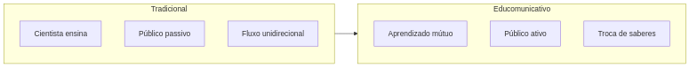
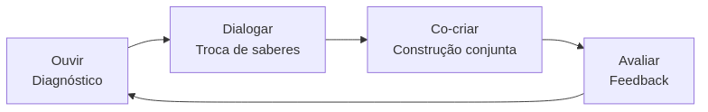
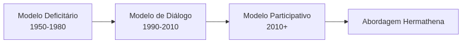
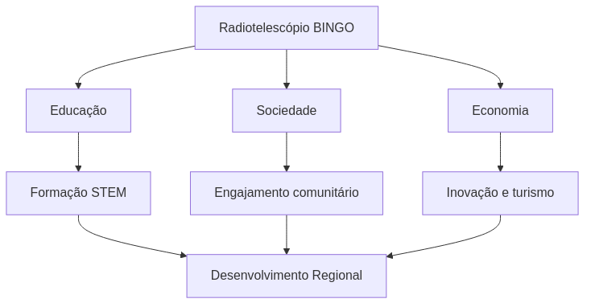
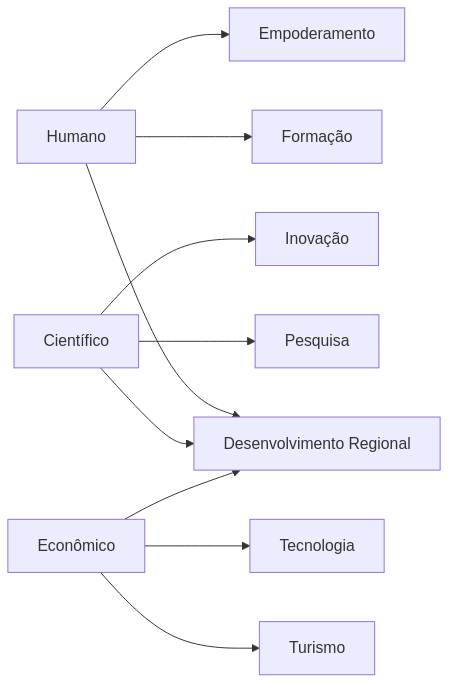
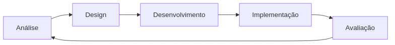
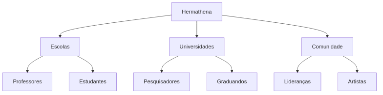

---
---

# Abordagem Educomunicativa

## Fundamentação Teórica

A **educomunicação** é um campo interdisciplinar que integra comunicação e educação, reconhecendo que:

> *"A comunicação é um processo educativo e a educação é um processo comunicativo"* — Soares e Melo (2020)

No Projeto Hermathena, adotamos a educomunicação como eixo central porque ela permite:

- **Diálogo horizontal** entre cientistas e público  
- **Construção conjunta** de conhecimento  
- **Contextualização** do conteúdo científico  
- **Empoderamento** dos participantes  

---

## Três Vertentes Teóricas

Essas três vertentes convergem para a criação de um ecossistema integrado de comunicação científica, educação e desenvolvimento regional, conectando a excelência científica do BINGO às demandas da sociedade paraibana.

---

## 1. Educomunicação

### Princípios Fundamentais

#### Diálogo Horizontal

---

### Processo Dialógico

---

### Aplicação no Projeto

**Exemplo: Produção de Material Didático**

1. **Pesquisa participativa**

   * Entrevistas com professores
   * Oficinas com estudantes
   * Consulta a especialistas

2. **Co-criação**

   * Workshops com educadores
   * Testes em sala de aula
   * Feedback contínuo

3. **Validação comunitária**

   * Revisão por professores
   * Ajustes à realidade local
   * Aprovação científica

---

## 2. Comunicação Pública da Ciência

### Evolução dos Modelos

---

### Modelo Participativo no Hermathena

* **Reconhecimento de expertise local**
* **Transparência científica**
* **Deliberação pública**
* **Responsividade social**

---

### Ciência em Contexto

| Tema Científico          | Conexão Local                          |
| ------------------------ | -------------------------------------- |
| Energia escura           | Metáforas com desenvolvimento regional |
| Radioastronomia          | Aplicações tecnológicas locais         |
| BAO                      | Escalas do Sertão ao universo          |
| Espectro eletromagnético | Comunicação por rádio                  |

---

## 3. Desenvolvimento Regional

### Integração Ciência–Território

---

### Impactos do BINGO

---

### Comunicação como Facilitadora

A comunicação científica potencializa:

1. **Visibilidade nacional**
2. **Educação de qualidade**
3. **Turismo científico**
4. **Atração de investimentos**

---

## 4. Metodologias

### Pipeline Educomunicativo

---

### Design Instrucional (ADDIE)

---

### Produção Colaborativa

---

## 5. Avaliação Participativa

### Instrumentos

1. **Pesquisa de percepção comunitária**
2. **Questionários de satisfação**
3. **Grupos focais**
4. **Estudos de caso**

---

## 6. Matriz de Conteúdos por Público

### Ensino Fundamental

| Tema          | Abordagem  | Produto   |
| ------------- | ---------- | --------- |
| Sistema Solar | Jogos      | Cartilhas |
| Estrelas      | Narrativas | Vídeos    |
| Universo      | Modelos    | Kits      |

### Ensino Médio

| Tema              | Abordagem    | Produto  |
| ----------------- | ------------ | -------- |
| Cosmologia        | Simulações   | Software |
| Radioastronomia   | Experimentos | Manual   |
| Método científico | Projetos     | Guia     |

### Educadores

| Tema                 | Abordagem | Produto   |
| -------------------- | --------- | --------- |
| Ensino de astronomia | Formação  | Curso     |
| Materiais didáticos  | Oficinas  | Tutoriais |

### Público Geral

| Tema              | Abordagem     | Produto   |
| ----------------- | ------------- | --------- |
| BINGO             | Documentários | YouTube   |
| Curiosidades      | Redes sociais | Posts     |
| Ciência cotidiana | Podcasts      | Episódios |

---

## Referências

* ALONSO, L. et al. (2023)
* IRWIN, A. (2008)
* LASTRES, H. et al. (2005)
* SOARES, I.; MELO, J. (2020)

---

*Metodologia adaptável conforme aprendizados do projeto.*

