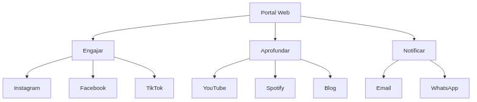
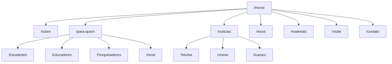
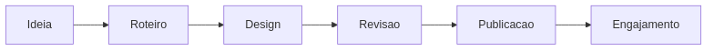
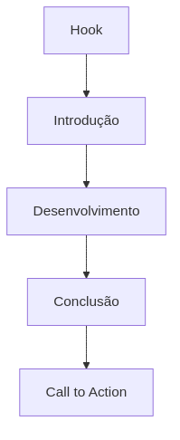
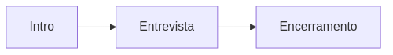
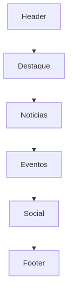
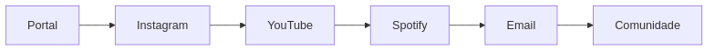

# Estratégia Multicanal

O Projeto Hermathena adota uma estratégia de comunicação multicanal, onde cada plataforma tem uma função específica no ecossistema de comunicação.

---

## Ecossistema Digital Hermathena

O portal web funciona como **hub central**, enquanto os demais canais desempenham funções complementares: engajamento, aprofundamento e notificação.

---

## 1. Portal Web (bingotelescope.org)

### Função

Central de conteúdo e repositório oficial de todos os materiais do projeto.

---

### Estrutura do Site

---

### Funcionalidades

| Funcionalidade   | Descrição                   | Prioridade |
| ---------------- | --------------------------- | ---------- |
| Sistema de busca | Encontrar conteúdo por tema | Alta       |
| Newsletter       | Cadastro para boletim       | Alta       |
| Downloads        | Materiais diversos          | Alta       |
| Blog             | Artigos e notícias          | Alta       |
| Agendamento      | Visitas                     | Média      |
| Multilíngue      | PT/EN                       | Média      |
| Acessibilidade   | Inclusão digital            | Alta       |

---

### Especificações Técnicas

* **Plataforma:** WordPress ou similar
* **Hospedagem:** VPS / Cloud
* **CDN:** CloudFlare
* **Analytics:** Google Analytics + Hotjar
* **SEO:** Yoast ou RankMath

---

## 2. Instagram

### Estratégia de Conteúdo

| Formato   | Frequência | Objetivo    |
| --------- | ---------- | ----------- |
| Carrossel | Diário     | Educação    |
| Reels     | 3x/semana  | Viralização |
| Stories   | Diário     | Engajamento |
| Live      | 2x/mês     | Interação   |

---

### Linhas Editoriais

* **#CosmoEm60Segundos**
* **#BINGONoDetalhe**
* **#ParaibaNoEspaco**
* **#DesafioSTEM**

---

### Fluxo de Conteúdo

---

### Métricas

* Seguidores: 5.000
* Engajamento: >5%
* Alcance: 100.000/mês
* Saves: indicador educacional

---

## 3. YouTube

### Séries de Conteúdo

| Série                 | Frequência | Duração   |
| --------------------- | ---------- | --------- |
| Cosmologia para Todos | 2x/mês     | 8-12 min  |
| Construindo o BINGO   | 1x/mês     | 10-15 min |
| Pergunte ao Cientista | Semanal    | 5-10 min  |
| Bastidores da Ciência | Mensal     | 15-20 min |

---

### Estrutura de Vídeo

---

### SEO

* Título otimizado
* Thumbnail chamativa
* Descrição com keywords
* Tags relevantes
* Legendas

---

## 4. Spotify (Podcasts)

### Programas

* **Cosmos em Foco** (entrevista, quinzenal)
* **BINGO Minuto** (notícias rápidas, semanal)

---

### Estrutura do Episódio

---

## 5. Email Marketing

### Tipos

| Tipo       | Frequência |
| ---------- | ---------- |
| Newsletter | Quinzenal  |
| Eventos    | Eventual   |
| Interno    | Mensal     |
| Relatórios | Trimestral |

---

### Estrutura

---

## 6. TikTok

### Estratégia

* Conteúdo dinâmico
* Linguagem informal
* Uso de trends

---

### Formatos

| Formato    | Exemplo                 |
| ---------- | ----------------------- |
| Explicação | "Por que o céu é azul?" |
| React      | Mitos científicos       |
| POV        | "Você é um fóton"       |
| Duet       | Respostas               |
| Bastidores | Vida no BINGO           |

---

## 7. Calendário Integrado

---

## 8. Métricas por Canal

| Canal     | Meta              |
| --------- | ----------------- |
| Portal    | 1.000 visitas/mês |
| Instagram | 5.000 seguidores  |
| YouTube   | 2.000 inscritos   |
| Spotify   | 500 downloads/mês |
| TikTok    | 3.000 seguidores  |
| Email     | 1.000 assinantes  |

---

## 9. Diretrizes

### Tom de Voz

* Acessível
* Inspirador
* Preciso
* Respeitoso
* Entusiasta

---

### Evitar

* Falta de revisão científica
* Ignorar público
* Conteúdo irregular
* Uso indevido de imagens

---

## 10. Recursos

### Ferramentas

| Ferramenta | Custo   |
| ---------- | ------- |
| Canva      | R$50    |
| Metricool  | R$80    |
| Adobe      | R$150   |
| Mailchimp  | R$0-100 |

---

### Equipe

| Função       | Tempo |
| ------------ | ----- |
| Social Media | 40h   |
| Designer     | 20h   |
| Redator      | 20h   |
| Editor vídeo | 30h   |

---

*Canais e estratégias evoluem conforme métricas.*
