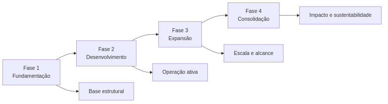
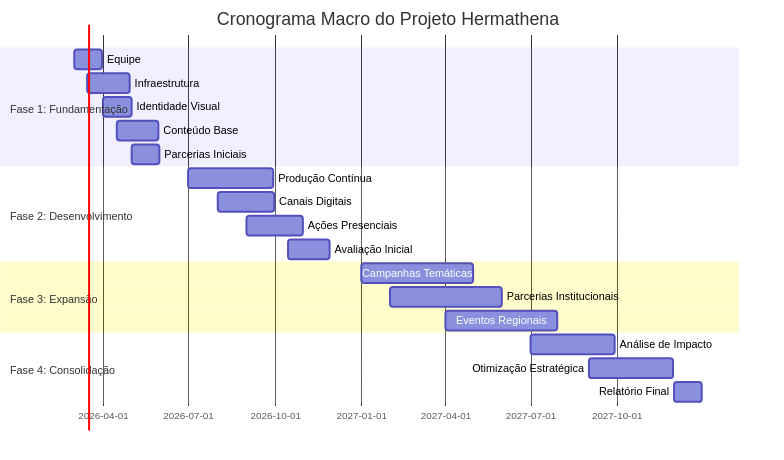
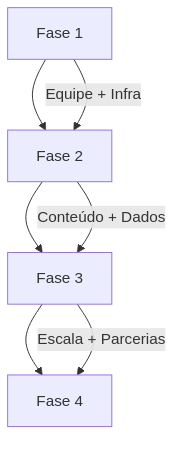
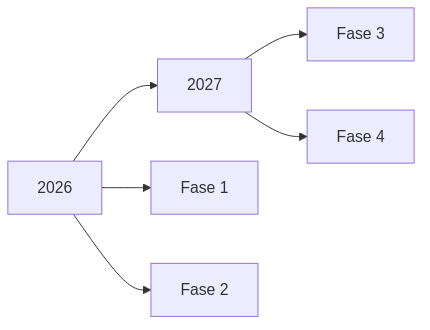

---
---

# Cronograma

## Visão Geral do Projeto

O cronograma do Projeto Hermathena está estruturado em quatro fases progressivas:

---

## Pipeline Geral

* **Setup** → Estruturação do projeto
* **Implementação** → Execução das ações
* **Expansão** → Ampliação do alcance
* **Consolidação** → Avaliação e sustentabilidade

---

## Cronograma Macro

---

## Interdependência entre Fases

---

## Marcos do Projeto

---

## Alinhamento com as Fases

### Fase 1 — Fundamentação

* Estrutura organizacional definida
* Infraestrutura operacional ativa
* Identidade visual consolidada

### Fase 2 — Desenvolvimento

* Produção contínua estabelecida
* Canais digitais ativos
* Primeiras ações presenciais realizadas

### Fase 3 — Expansão

* Ampliação de alcance
* Parcerias institucionais consolidadas
* Eventos regionais estruturados

### Fase 4 — Consolidação

* Avaliação de impacto
* Ajustes estratégicos
* Sustentabilidade do projeto

---

## Visão Temporal Simplificada

---

## Considerações

* O cronograma é **adaptável** conforme disponibilidade de recursos
* As fases possuem **sobreposição parcial**, garantindo continuidade
* O modelo privilegia **aprendizado contínuo e ajuste iterativo**

---
## Integração com Recursos

A execução do cronograma está diretamente associada à disponibilidade de recursos financeiros e humanos.

- **Fase 1:** baixa intensidade financeira (setup)
- **Fase 2:** aumento de custeio (produção contínua)
- **Fase 3:** maior demanda operacional (expansão)
- **Fase 4:** foco em consolidação e sustentabilidade

A distribuição orçamentária foi planejada para acompanhar essa progressão, garantindo viabilidade ao longo de todo o ciclo do projeto.

Ver detalhamento em: `orcamento.md`

---

*Cronograma sujeito a ajustes conforme evolução do projeto e disponibilidade de recursos.*

