---
---

# Fase 1: Fundamentação (Meses 1-4)

## Visão Geral

A Fase 1 do Projeto Hermathena estabelece as bases estruturais, técnicas e humanas necessárias para o funcionamento do projeto. É o período de setup, onde são definidos processos, formada a equipe e preparada a infraestrutura para as ações futuras.

---

## Objetivos da Fase

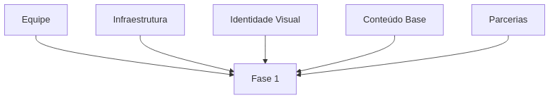

1. Estruturar a equipe
2. Estabelecer infraestrutura
3. Desenvolver identidade visual
4. Produzir conteúdo base
5. Mapear parceiros

---

## Pipeline da Fase

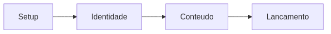

* **Setup** → equipe + infraestrutura
* **Identidade** → marca + materiais
* **Conteúdo** → produção inicial
* **Lançamento** → ativação pública

---

## Cronograma Geral

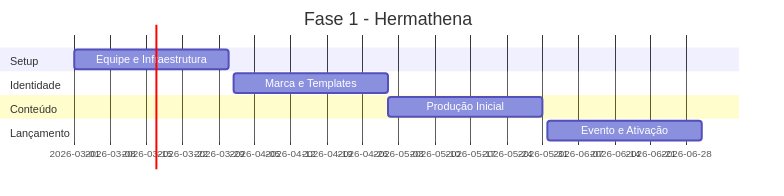

---

## 1. Mês 1: Setup Inicial

### Fluxo do Mês

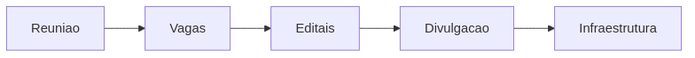

### Entregáveis

* Organograma funcional definido
* Editais publicados
* Infraestrutura digital configurada
* Repositório Git criado

---

## 2. Mês 2: Identidade e Mapeamento

### Fluxo do Mês

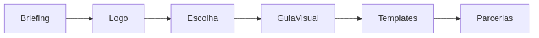

### Entregáveis

* Logomarca do projeto
* Manual de identidade visual
* Templates para redes sociais
* Base de parceiros potenciais
* Propostas institucionais

---

## 3. Mês 3: Produção de Conteúdo

### Fluxo do Mês

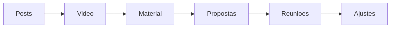

### Entregáveis

* 20 posts institucionais
* Vídeo de apresentação
* Material gráfico
* Propostas enviadas
* Reuniões realizadas

---

## 4. Mês 4: Lançamento

### Fluxo do Mês

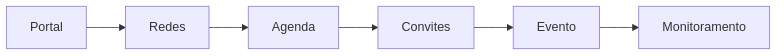

### Entregáveis

* Portal web no ar
* Redes sociais ativas
* Evento realizado
* Conteúdo publicado
* Relatório inicial

---

## Marco: Evento de Lançamento

### Estrutura do Evento

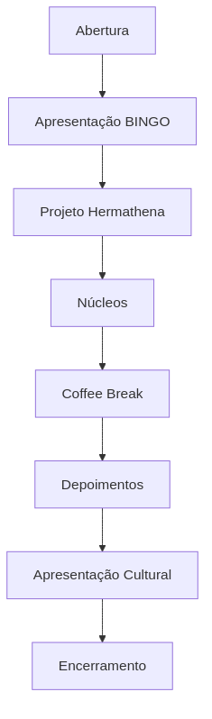

---

### Informações

* **Formato:** Híbrido
* **Local:** UFCG
* **Público:** 50 presencial + online

---

## Recursos da Fase

### Distribuição Financeira

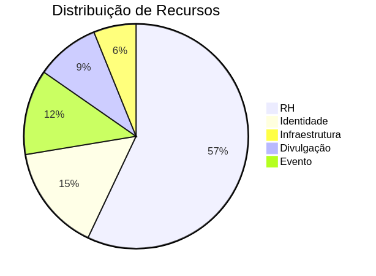

---

### Equipe

* Coordenador geral
* 3 bolsistas
* Designer
* Voluntários

---

## Riscos e Mitigação

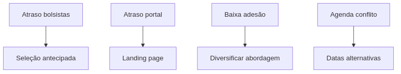

---

## Indicadores de Sucesso

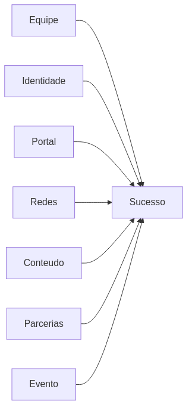

---

## Dependências

* PROBEX (aprovado)
* Recursos financeiros
* Editais
* Acesso ao BINGO
* Apoio institucional

---

## Avaliação e Aprendizado

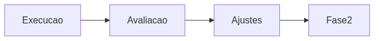

---

## Checklist de Transição

* Equipe completa
* Identidade consolidada
* Portal funcional
* Redes ativas
* Parcerias iniciadas
* Evento realizado
* Relatório entregue

---

*Fase 1 concluída = Base sólida para implementação completa*

