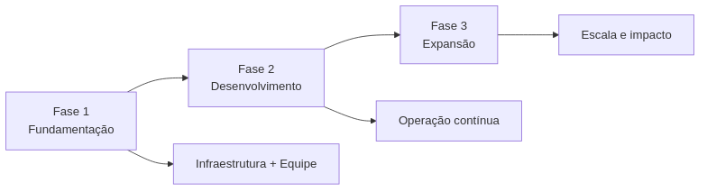
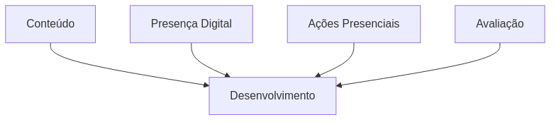
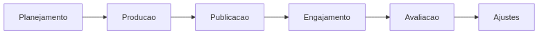
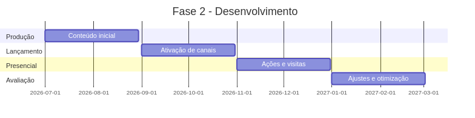
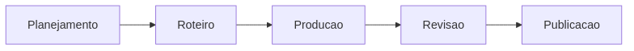
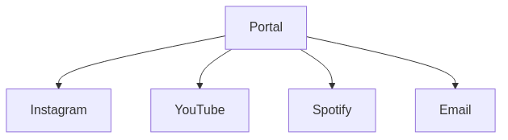
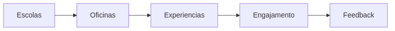
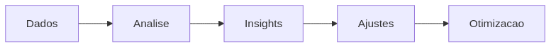
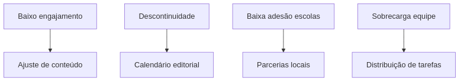
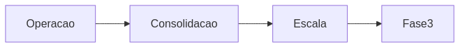

---
---

# Fase 2: Desenvolvimento (Meses 5-12)

## Visão Geral

A Fase 2 corresponde à etapa de **implementação e consolidação operacional** do Projeto Hermathena. Após o setup inicial, o projeto passa a operar plenamente, com produção contínua de conteúdo, ativação dos canais e realização de ações presenciais.

---

## Papel da Fase 2 no Projeto

---

## Objetivos

* Produzir e publicar conteúdo regularmente
* Consolidar presença digital multicanal
* Realizar ações presenciais e educacionais
* Coletar dados e feedback contínuo

---

## Pipeline Operacional

👉 Esse ciclo passa a operar continuamente ao longo de toda a fase.

---

## Cronograma Estruturado

---

## 1. Produção de Conteúdo (Meses 5-6)

### Fluxo

### Ações

* Produção de conteúdos para redes sociais
* Gravação de vídeos institucionais
* Produção de materiais educacionais
* Criação de biblioteca inicial

### Entregáveis

* 50+ peças de conteúdo
* 5 vídeos estruturados
* Materiais educacionais iniciais

---

## 2. Lançamento de Canais (Meses 7-8)

### Ecossistema em Operação

### Ações

* Ativação oficial dos canais
* Primeiras campanhas digitais
* Integração entre plataformas
* Início de calendário editorial

### Entregáveis

* Canais ativos e integrados
* Primeiros seguidores e audiência
* Rotina de publicação estabelecida

---

## 3. Ações Presenciais (Meses 9-10)

### Dinâmica de Atuação

### Ações

* Visitas a escolas
* Oficinas educacionais
* Participação em eventos
* Atividades comunitárias

### Entregáveis

* 5–10 escolas atendidas
* 2–3 eventos realizados
* Relatórios de campo

---

## 4. Avaliação e Ajustes (Meses 11-12)

### Ciclo de Melhoria

### Ações

* Coleta de métricas digitais
* Análise de engajamento
* Feedback de participantes
* Ajustes de estratégia

### Entregáveis

* Relatório de desempenho
* Ajustes operacionais
* Planejamento da Fase 3

---

## Indicadores de Sucesso

| Dimensão    | Indicador                  | Meta    |
| ----------- | -------------------------- | ------- |
| Conteúdo    | Produções publicadas       | 100+    |
| Digital     | Seguidores totais          | 5.000+  |
| Engajamento | Taxa média                 | >5%     |
| Presencial  | Escolas atendidas          | 10      |
| Alcance     | Pessoas impactadas         | 1.000+  |
| Operação    | Regularidade de publicação | Semanal |

---

## Riscos e Mitigação

---

## Transição para Fase 3

---

## Checklist de Conclusão

* [ ] Produção contínua estabelecida
* [ ] Canais consolidados
* [ ] Ações presenciais realizadas
* [ ] Métricas coletadas
* [ ] Relatório de avaliação concluído
* [ ] Planejamento da Fase 3 definido

---
