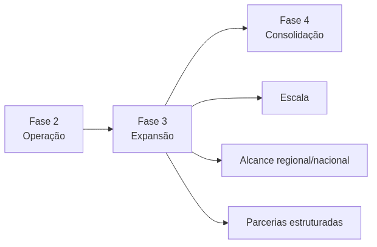
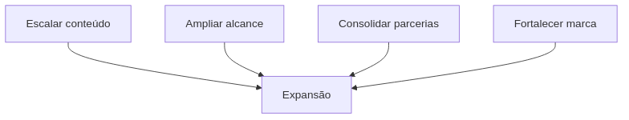
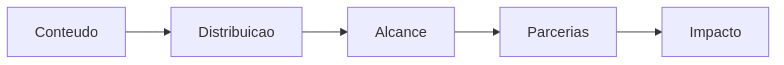
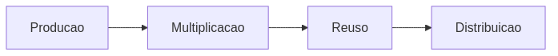
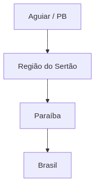
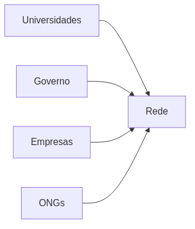
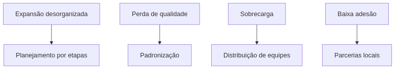
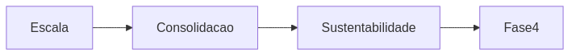

---
---

# Fase 3: Expansão (Meses 13-24)

## Visão Geral

A Fase 3 marca a transição do Projeto Hermathena de uma operação consolidada para uma estratégia de **escala e ampliação de impacto**, expandindo sua atuação territorial, institucional e digital.

---

## Papel da Fase 3

---

## Objetivos

* Expandir produção e distribuição de conteúdo
* Ampliar presença regional e nacional
* Formalizar parcerias institucionais
* Fortalecer a identidade do projeto

---

## Estratégia de Expansão

---

## 1. Escala de Conteúdo

### Fluxo

### Ações

* Reaproveitamento de conteúdos em múltiplos formatos
* Tradução/adaptação para novos públicos
* Aumento da frequência de publicação
* Criação de séries temáticas

### Entregáveis

* Biblioteca consolidada de conteúdo
* Séries estruturadas por tema
* Presença consistente em múltiplos canais

---

## 2. Expansão Territorial

### Dinâmica

### Ações

* Ampliação para novas escolas e municípios
* Participação em eventos regionais
* Parcerias com secretarias de educação
* Interiorização das ações

### Entregáveis

* 20+ instituições atendidas
* Atuação em múltiplos municípios
* Inserção em agendas regionais

---

## 3. Parcerias Institucionais

### Estrutura

### Ações

* Formalização de convênios
* Cooperação com universidades
* Aproximação com setor produtivo
* Captação de apoio institucional

### Entregáveis

* 5–10 parcerias formalizadas
* Projetos conjuntos iniciados
* Ampliação da rede Hermathena

---

## 4. Eventos e Campanhas

### Estrutura

### Ações

* Campanhas temáticas (astronomia, ciência, tecnologia)
* Eventos presenciais e híbridos
* Participação em feiras e mostras científicas
* Produção de eventos próprios

### Entregáveis

* 5+ eventos realizados
* Campanhas com alto alcance
* Cobertura midiática

---

## Indicadores de Sucesso

| Dimensão    | Indicador            | Meta    |
| ----------- | -------------------- | ------- |
| Alcance     | Pessoas impactadas   | 10.000+ |
| Conteúdo    | Produções acumuladas | 300+    |
| Parcerias   | Instituições         | 10      |
| Territorial | Municípios atendidos | 5+      |
| Digital     | Seguidores totais    | 15.000+ |

---

## Riscos e Mitigação

---

## Transição para Fase 4

---

## Checklist

* [ ] Expansão territorial iniciada
* [ ] Parcerias formalizadas
* [ ] Conteúdo escalado
* [ ] Eventos realizados
* [ ] Marca consolidada

---
