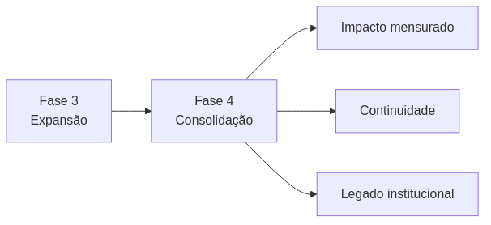
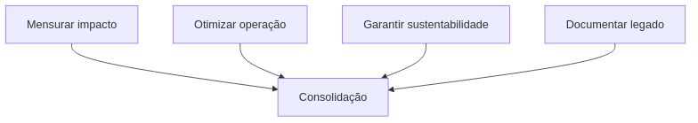
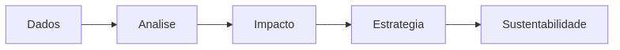
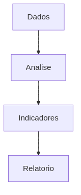
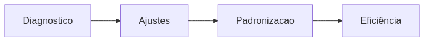
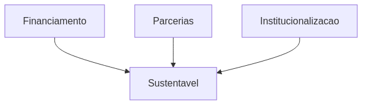
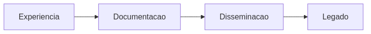
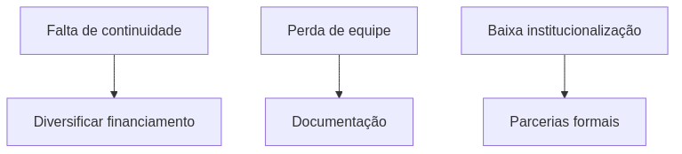
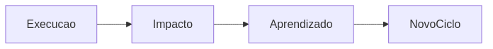

---
---

# Fase 4: Consolidação (Meses 25-36)

## Visão Geral

A Fase 4 representa a maturidade do Projeto Hermathena, com foco na **avaliação de impacto, consolidação institucional e sustentabilidade de longo prazo**.

---

## Papel da Fase 4

---

## Objetivos

* Avaliar impacto educacional e social
* Consolidar processos e governança
* Garantir continuidade do projeto
* Produzir documentação final

---

## Modelo de Consolidação

---

## 1. Avaliação de Impacto

### Estrutura

### Ações

* Análise de métricas digitais
* Avaliação de impacto educacional
* Estudos qualitativos (casos)
* Consolidação de indicadores

### Entregáveis

* Relatório de impacto
* Indicadores consolidados
* Evidências qualitativas

---

## 2. Otimização Operacional

### Fluxo

### Ações

* Revisão de processos
* Padronização de fluxos
* Otimização de recursos
* Melhoria de governança

### Entregáveis

* Manual operacional
* Processos documentados
* Estrutura otimizada

---

## 3. Sustentabilidade

### Modelo

### Ações

* Captação de recursos contínuos
* Fortalecimento de parcerias
* Inserção institucional permanente
* Busca de novos editais

### Entregáveis

* Plano de sustentabilidade
* Novos financiamentos
* Continuidade garantida

---

## 4. Documentação e Legado

### Estrutura

### Ações

* Produção de relatórios finais
* Publicações acadêmicas
* Compartilhamento de metodologias
* Criação de repositório aberto

### Entregáveis

* Relatório final do projeto
* Artigos/publicações
* Materiais abertos

---

## Indicadores de Sucesso

| Dimensão         | Indicador              | Meta    |
| ---------------- | ---------------------- | ------- |
| Impacto          | Pessoas alcançadas     | 20.000+ |
| Educação         | Escolas atendidas      | 20+     |
| Sustentabilidade | Novos financiamentos   | 2+      |
| Produção         | Documentos/publicações | 5+      |
| Institucional    | Parcerias ativas       | 10+     |

---

## Riscos e Mitigação

---

## Encerramento do Ciclo

---

## Checklist Final

* [ ] Impacto avaliado
* [ ] Processos documentados
* [ ] Sustentabilidade definida
* [ ] Relatório final entregue
* [ ] Continuidade estruturada

---
