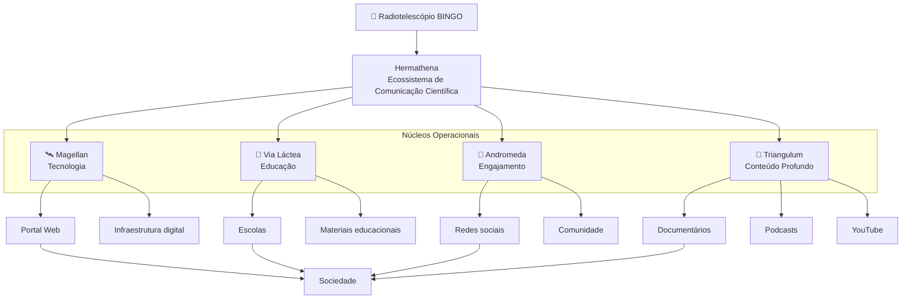

# Ecossistema Hermathena

O Projeto Hermathena organiza as ações de comunicação científica do radiotelescópio **BINGO** como um ecossistema integrado de núcleos especializados.

Cada núcleo atua em uma dimensão específica da comunicação científica, permitindo transformar a presença do radiotelescópio no sertão paraibano em uma plataforma de **educação, inovação e desenvolvimento regional**.

